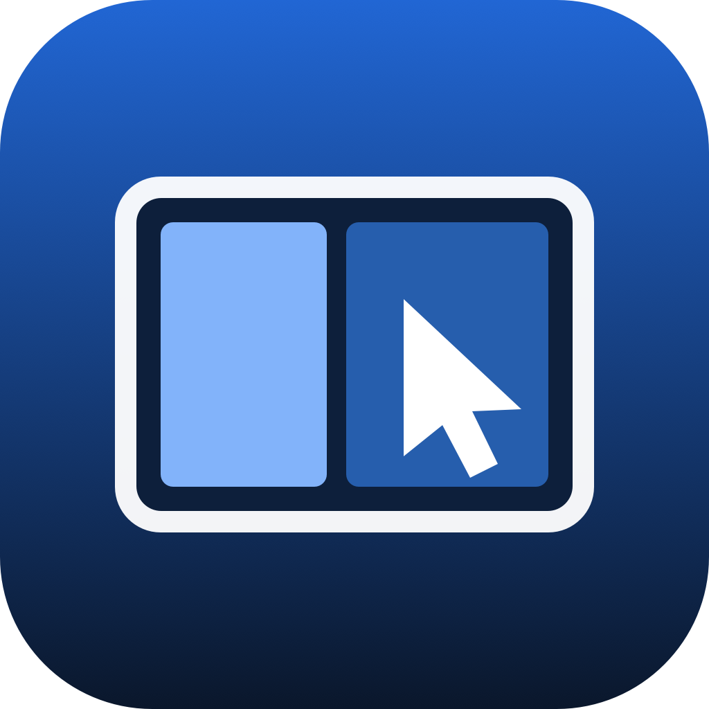
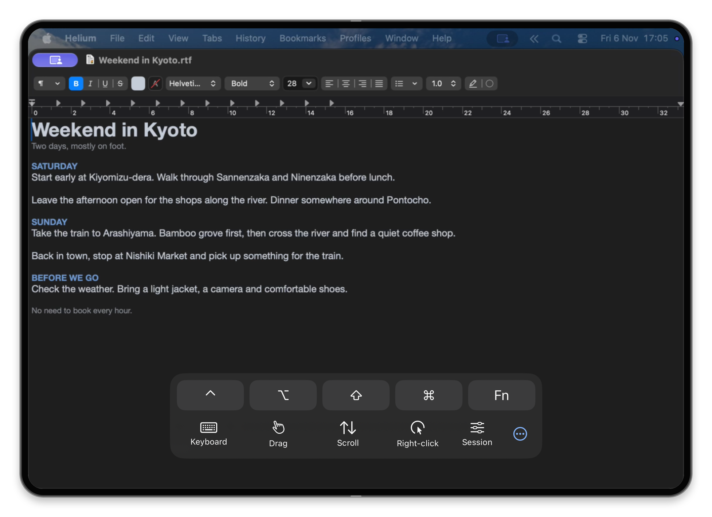
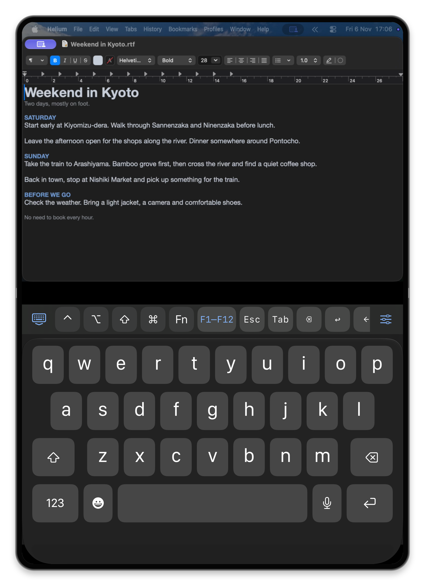
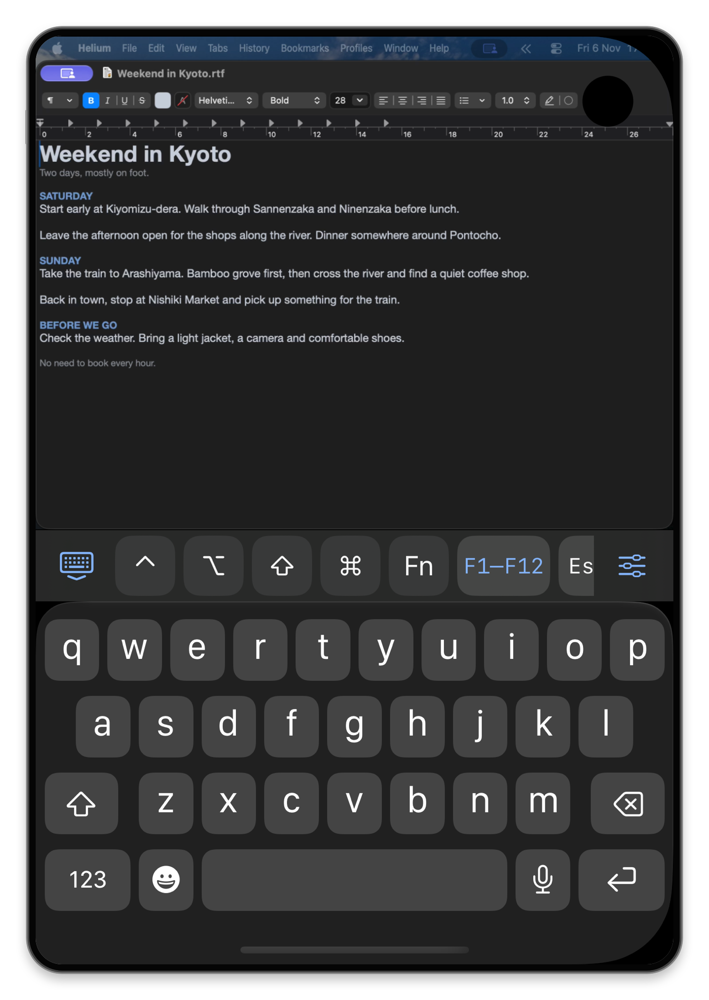

  

<h1 align="center">Duo Workspace</h1>

Remote desktop and a second display for iPhone Duo and iPad, over a local network or VPN.

  <a href="Documentation/Development.md">Build</a> ·
  <a href="Documentation/Usage.md">Usage</a> ·
  <a href="Documentation/Security.md">Security</a> ·
  <a href="CONTRIBUTING.md">Contribute</a>

| Control Mac | Use as Display |
| --- | --- |
| Work on the Mac desktop and windows you already have open. | Add a temporary desktop that resizes to fit your device. Disconnecting removes it. |

Tap, drag, scroll and right-click. Type with Mac modifiers, Fn and F1–F12. Share text and files. Play Mac audio or send the iPhone microphone back.

Native touch sends up to five fingers to macOS 27.3 and needs virtual-HID authorization. See [setup](Documentation/NativeTouch.md).

| Tabletop controls | Keyboard |
| --- | --- |
|  |  |

Simulator screenshots shown in rendered Duo frames.

Automatic sizing follows the available workspace. Fixed shapes, including 16:9 and 3:4, keep the Mac desktop at its chosen size as you rotate or fold. Workspace size and picture quality have separate settings.

## Build and connect

1. Build both apps with Xcode 27.3 using the [build guide](Documentation/Development.md). Local host signing is automatic.
2. Open **Duo Workspace Host**. Allow screen recording and Accessibility, start sharing, then create and copy an invitation.
3. Choose **Add Mac**, paste the invitation and select **Pair**. Compare the six-digit codes and approve on the Mac only if they match.

Each device needs its own approval. Connections use TLS 1.3, and the Mac can revoke a device's access at any time.

## Status

[MIT-licensed](LICENSE) and built from source. Headless Macs and undocked closed-lid operation still need testing. For Internet access, use a reachable Mac address through your VPN.

[Architecture](Documentation/Architecture.md)
